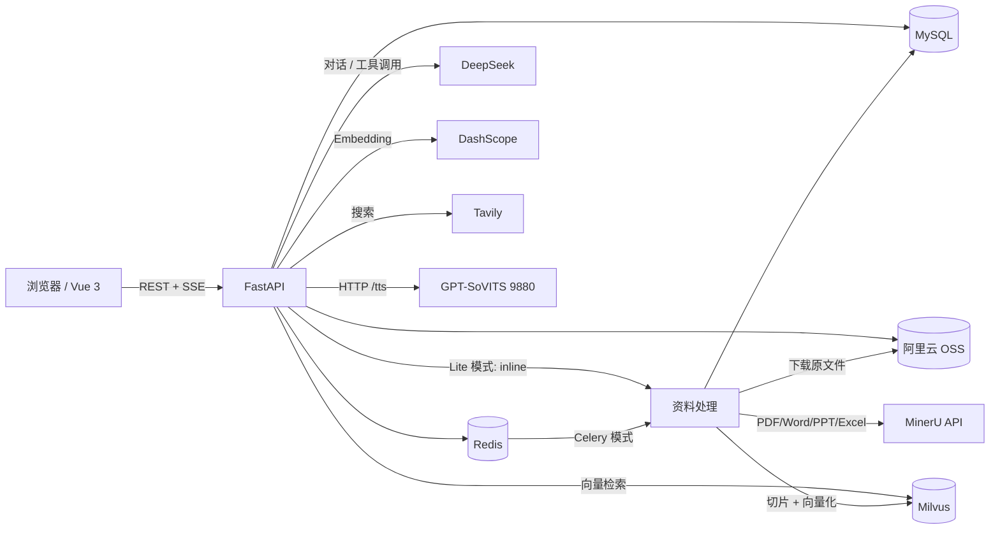

# Campus Copilot Pro 3.0（校园 AI 助手）

一个面向校园场景的全栈 AI 助手：查课表、管学习计划、上传课件做 RAG 问答，通过 SSE 流式返回文字，并用 GPT-SoVITS 做句子级语音播报。

前端是 Vue 3 + Element Plus，后端是 FastAPI + MySQL + Redis + Milvus。模型侧使用 DeepSeek、DashScope Embedding、MinerU、Tavily，以及本地 GPT-SoVITS V2ProPlus。

> 3.0 的核心变化：语音链路从「腾讯云 TTS + RVC」切换为「本地 GPT-SoVITS 直接生成目标音色」，并加入多语气标签、标签隐藏、Tavily 联网搜索和 Markdown 安全渲染。

## 版本

| 版本 | 分支 | 主要变化 |
|---|---|---|
| 1.0 | `main` | 校园 AI 助手基础版：对话、课表、学习计划、资料 RAG |
| 2.0 | `release/v2.0` | 腾讯云 TTS + RVC、句子级语音队列、Tavily 联网搜索 |
| 3.0 | `release/v3.0` | GPT-SoVITS V2ProPlus、多语气标签、标签隐藏、语音链路重构 |

## 功能

- **AI 对话**：DeepSeek 流式输出，SSE 推送，支持多会话与历史恢复。
- **Markdown 渲染**：`marked` 解析 + `DOMPurify` 净化，支持标题、列表、代码块、表格、引用和链接。
- **课表**：CSV / Excel 导入、新增/编辑/删除、时段冲突校验；AI 可按“今天/明天/周四”“上午/下午”查课。
- **学习计划**：AI 先问清课程、截止时间、复习情况，用户确认“就这些”后才写库；页面勾选进度、删除计划，过期自动清理。
- **课程资料 RAG**：PDF / Word / PPT / Excel / Markdown 上传到 OSS，MinerU 转 Markdown，按标题切片后写入 Milvus；提问时向量 + BM25 混合检索，RRF 融合，回答注明出处。
- **语音播报**：GPT-SoVITS 按句合成，前端预取/顺序播放，并在语音条同步当前句。
- **多语气标签**：支持 `[激动][气喘吁吁]` 这种叠加标签，标签只用于语音，不显示、不朗读。
- **联网搜索**：LangChain Tavily 搜索 + 公开网页正文读取，回答附来源。
- **用户管理**：JWT 登录、Refresh Token 轮换、Redis 在线状态、禁用即踢下线、管理员用户 CRUD。
- **并发保护**：课表整表覆盖使用 Redis 用户级锁，避免并发删除/插入造成 MySQL 死锁。

## 技术栈

| 层 | 技术 |
|---|---|
| 前端 | Vue 3、Vite、TypeScript、Element Plus、Pinia、Axios、marked、DOMPurify |
| 后端 | FastAPI、Pydantic、SQLAlchemy 2（async）、Uvicorn |
| 数据库 | MySQL 8（会话、课表、计划、资料元数据） |
| 缓存 | Redis（Refresh Token、用户状态、课表锁、Celery broker） |
| 向量库 | Milvus Lite（本地）/ Milvus Standalone（远程） |
| 大模型 | DeepSeek（OpenAI 兼容接口）、DashScope Embedding |
| 文档解析 | MinerU 云端 API、pypdf（PDF 超页拆分） |
| 检索 | 向量检索 + jieba + BM25，RRF 融合 |
| 语音 | GPT-SoVITS V2ProPlus（本地 CUDA）；腾讯云 TTS + RVC 保留为旧 provider |
| 联网搜索 | LangChain TavilySearchResults + 网页正文读取 |
| 异步任务 | Celery + Redis（仅远程 Milvus 模式） |

## 架构



资料处理有两种模式：

- **inline**：Milvus Lite 只允许单进程访问，资料解析直接在 FastAPI 进程内跑；
- **celery**：Milvus Standalone 时由 Celery Worker 处理，API 与 Worker 可以分开部署。

GPT-SoVITS 是独立的常驻推理服务，不嵌在 FastAPI 里。它负责把文字合成 WAV；后端只通过 HTTP 调用，不再经过 RVC。

## 目录结构

```text
campus_copilot_pro/
├── backend/
│   ├── app/
│   │   ├── api/            # 路由：auth / chat / conversation / course / material / study_plan / users / tts
│   │   ├── core/           # Agent、工具、提示词、TTS、联网搜索、MinerU、OSS、Embedding、Celery
│   │   ├── db/             # MySQL Session、Redis、Milvus 客户端
│   │   ├── models/         # SQLAlchemy 模型
│   │   ├── repositories/   # 数据访问
│   │   ├── schemas/        # Pydantic 请求/响应
│   │   ├── services/       # 业务逻辑：对话、检索、资料、课表、计划
│   │   ├── tasks/          # Celery 任务
│   │   └── main.py
│   ├── sql/chat_tables.sql # 会话/消息表 DDL
│   ├── tests/load/         # HTTP、SSE、资料入库压测脚本
│   ├── requirements.txt
│   └── start_worker.bat    # Windows Celery 启动脚本
├── frontend/
│   └── src/
│       ├── api/            # Axios 接口封装
│       ├── components/     # MarkdownContent 等
│       ├── layouts/        # 侧边栏布局
│       ├── stores/         # Pinia：auth / chat / schedule / studyPlan / users / speech
│       ├── views/          # Chat / Schedule / Plan / Materials / Users / Login
│       └── utils/          # CSV/Excel 课表解析
└── open_ssh.bat            # 本地 Redis SSH 隧道（示例）
```

## 本地运行

### 环境要求

- Python 3.11+
- Node.js 20.19+ / 22.12+
- MySQL 8+
- Redis 6+
- 阿里云 OSS Bucket
- DeepSeek、DashScope、MinerU、Tavily 的 API Key
- GPT-SoVITS 单独环境（Python 3.10，CUDA 可选但推荐）

### 1. 初始化数据库

```sql
CREATE DATABASE IF NOT EXISTS campus_agent
  DEFAULT CHARACTER SET utf8mb4
  COLLATE utf8mb4_unicode_ci;
```

业务表结构以 `backend/app/models/` 为准；会话与消息表可直接执行：

```bash
mysql -u root -p campus_agent < backend/sql/chat_tables.sql
```

### 2. 配置后端

```bash
cd backend
python -m venv .venv
# Windows
.venv\Scripts\activate
# macOS / Linux
# source .venv/bin/activate

pip install -r requirements.txt
copy .env.example .env   # Windows
# cp .env.example .env   # macOS / Linux
```

编辑 `backend/.env`，至少填写：

| 变量 | 说明 |
|---|---|
| `DATABASE_URL` | MySQL 异步连接串，`mysql+aiomysql://...` |
| `REDIS_HOST` / `REDIS_PORT` / `REDIS_PASSWORD` | Redis 地址；本地可通过 SSH 隧道 |
| `JWT_SECRET_KEY` | 随机字符串，生产必须更换 |
| `DEEPSEEK_APIKEY` | DeepSeek API Key |
| `DASHSCOPE_APIKEY` | Embedding API Key |
| `OSS_ACCESS_KEY_ID` / `OSS_ACCESS_KEY_SECRET` | 阿里云 OSS 凭证 |
| `OSS_BUCKET_NAME` / `OSS_ENDPOINT` | Bucket 与 Endpoint |
| `MINERU_API_TOKEN` | MinerU 云端解析 Token |
| `MILVUS_ENDPOINT` | 本地 Lite 填文件路径；远程填 `http://ip:19530` |
| `MATERIAL_TASK_MODE` | `auto` / `inline` / `celery` |
| `TTS_PROVIDER` | `gpt_sovits`（默认）/ `tencent` |
| `TAVILY_API_KEY` | Tavily 搜索 Key |

> `.env` 已加入 `.gitignore`，不要提交真实密钥。

### 3. 启动后端

```bash
cd backend
uvicorn app.main:app --reload --port 8000
```

接口文档：<http://127.0.0.1:8000/docs>

### 4. 启动前端

```bash
cd frontend
npm install
npm run dev
```

默认访问 <http://localhost:5173>，Vite 会把 `/api` 代理到 `127.0.0.1:8000`。

### 5. 启动 GPT-SoVITS 语音服务（可选）

3.0 默认使用 GPT-SoVITS V2ProPlus。语音服务需要单独部署：

```bash
cd /path/to/GPT-SoVITS
python api_v2.py -a 127.0.0.1 -p 9880 -c GPT_SoVITS/configs/tts_infer.yaml
```

后端 `.env` 参考：

```env
TTS_PROVIDER=gpt_sovits
GPT_SOVITS_BASE_URL=http://127.0.0.1:9880
GPT_SOVITS_REF_AUDIO=D:/path/to/reference.wav
GPT_SOVITS_PROMPT_TEXT=参考音频对应的台词
GPT_SOVITS_PROMPT_LANG=ja
GPT_SOVITS_TEXT_LANG=auto
GPT_SOVITS_SPEED=1.0
GPT_SOVITS_TIMEOUT_SECONDS=180
RVC_ENABLED=false
```

说明：

- `GPT_SOVITS_PROMPT_LANG` 是参考音频的语言，不是输出语言；
- `GPT_SOVITS_TEXT_LANG=auto` 会按句识别中/日文；
- 模型权重、参考音频、基座模型都不在仓库里；
- 服务未启动时，文字聊天不受影响，`/api/tts/speech` 返回 502；
- 旧腾讯云 TTS + RVC 链路仍保留，把 `TTS_PROVIDER` 改成 `tencent` 可切回。

### 6. 旧链路：腾讯云 TTS + RVC

只有切回 `TTS_PROVIDER=tencent` 时才需要：

```env
TTS_PROVIDER=tencent
RVC_ENABLED=true
RVC_SERVICE_URL=http://127.0.0.1:8010
```

RVC 是独立微服务，模型和启动方式按本地环境配置；3.0 默认不再依赖它。

## 资料处理与检索

### 上传链路

1. 前端上传文件，后端校验类型（PDF / DOC / DOCX / PPT / PPTX / XLS / XLSX / MD）和 20 MB 大小上限；
2. 文件以 UUID 命名写入 OSS，路径形如 `materials/{user_id}/{uuid}.{ext}`；
3. MySQL 插入 `course_materials`，状态 `0-待处理`，随后投递解析任务；
4. 解析任务下载原文件：
   - Markdown 直接读取；
   - 其它格式调用 MinerU 转 Markdown；
   - PDF 超过 MinerU 200 页限制时，用 pypdf 按 200 页拆成多个文件分别解析后合并；
5. 按 Markdown 标题（`# / ## / ###`）切小节，节内按约 500 字再切，表格单独成块，块首拼接章节路径；
6. DashScope `qwen3.7-text-embedding-flash` 生成 1024 维向量，写入 Milvus（带 `user_id`、`material_id`、`file_name`、`chunk_index`）；
7. 成功后状态 `2-已索引` 并写入 `chunk_count`；失败写 `3-失败` 和 `error_msg`。

### 混合检索

- 向量路：Milvus COSINE 相似度取 top 20；
- 关键词路：当前用户切片 + jieba 分词 + BM25 取 top 20；
- RRF：`score = Σ 1 / (60 + rank)`，融合后取 top 5；
- 两路都强制按 `user_id` 过滤，避免跨用户检索。

### 状态机

```text
0 待处理 → 1 解析中 → 2 已索引
                    └→ 3 失败（error_msg）
```

> 注意：`inline` 模式下任务运行在 FastAPI 进程里。如果解析期间重启后端，任务会丢失，资料可能永久停在 `1-解析中`；这时需要重新上传或后续补充“重新索引”机制。大 PDF 解析 + 456 个切片通常需要 2 分钟左右，不一定是卡死。

## 语音标签

提示词要求模型在段落开头输出语气标签：

```text
[气喘吁吁]嗯嗯，莫提斯听到了。
[激动][气喘吁吁]嗯嗯，找我吗？
[小声][低落]……没事的，嗯嗯。
```

处理规则：

- 前端从显示内容中隐藏标签，正文只显示台词；
- 后端清洗标签和动作括号，标签不会进入 TTS 正文；
- 支持多个标签叠加，后端把语速、音量、情感合并；
- GPT-SoVITS 没有腾讯云那种情感分类，标签目前主要影响语速等轻量参数；
- 这是“用目标音色朗读”，不是带旋律的歌声合成。

## API 概览

| 方法 | 路径 | 说明 |
|---|---|---|
| POST | `/api/auth/login` | 登录，AT 放响应体，RT 放 httpOnly Cookie |
| POST | `/api/auth/refresh` | 刷新 Token（RTR） |
| POST | `/api/auth/logout` | 退出登录 |
| GET | `/api/auth/me` | 当前用户 |
| GET/POST | `/api/conversations` | 会话列表 / 新建会话 |
| GET | `/api/conversations/{id}/messages` | 会话消息 |
| DELETE | `/api/conversations/{id}` | 删除会话 |
| POST | `/api/chat/stream` | 流式对话（SSE） |
| POST | `/api/tts/speech` | 一句文本合成语音（WAV） |
| GET/PUT | `/api/courses` | 查询 / 整表保存课表 |
| GET | `/api/study-plans` | 学习计划列表 |
| PATCH | `/api/study-plans/{id}/tasks/{task_id}` | 勾选任务 |
| DELETE | `/api/study-plans/{id}` | 删除计划 |
| POST | `/api/materials/upload` | 上传课程资料 |
| GET | `/api/materials` | 资料列表 |
| GET | `/api/materials/{id}/download-url` | OSS 预签名下载地址 |
| DELETE | `/api/materials/{id}` | 删除资料及向量 |
| GET/POST | `/api/users` | 用户列表 / 新建用户（管理员） |
| PUT | `/api/users/{id}` | 编辑用户（管理员） |
| PATCH | `/api/users/{id}/status` | 禁用 / 启用用户（管理员） |
| DELETE | `/api/users/{id}` | 删除用户（管理员） |

## Agent 工具

| 工具 | 作用 |
|---|---|
| `get_current_time` | 当前日期、星期、时间、时段 |
| `query_schedule` | 查数据库课表，支持按星期/日期和上午/下午过滤 |
| `query_study_plan` | 查学习计划与任务完成情况 |
| `create_study_plan` | 用户确认后写入学习计划和任务 |
| `search_course_material` | 课程资料混合检索，返回片段与文件名 |
| `web_search` | Tavily 联网搜索，返回标题、链接和摘要 |
| `read_web_page` | 读取公开网页正文，带内网/大小限制 |

学习计划有固定的澄清流程：先问课程、截止时间、复习情况，再给任务清单，最后问“就这些？”，用户确认后才允许调用创建工具。

## 已知限制

- **Milvus Lite 单进程**：不能同时启动 FastAPI 和 Celery Worker 访问同一个 Lite 文件，所以 `auto` 模式在 Lite 下使用 inline；切到 Standalone 后再用 Celery。
- **inline 任务不持久**：后端重启会丢失正在解析的任务，状态可能停在 `1-解析中`；当前没有自动重试。
- **BM25 每次查询会拉取当前用户的全部切片**：课程项目量级够用，切片上万后建议改用 Milvus 原生 BM25 + `hybrid_search`。
- **上下文只取最近 40 条消息**：`conversations.summary` 字段已预留，摘要压缩尚未实现。
- **PDF 自动拆分只处理页数**：加密或损坏的 PDF 可能无法拆分，会回退为原文件解析并返回 MinerU 的错误。
- **没有限流**：登录、聊天、上传都还没有做频率控制，公网部署前需要补。
- **GPT-SoVITS 是独立服务**：需要单独准备模型、Python 环境和 GPU；6GB 显存偏紧，首次加载较慢，服务必须常驻。
- **语音标签能力有限**：GPT-SoVITS 没有腾讯云那种情感分类，标签目前主要影响语速；不是带旋律的歌声合成。
- **没有 ASR**：当前只做文字和语音输出，不包含语音输入。
- **没有自动化测试/CI**：目前以接口脚本和手工流程验证为主。

## 压测

项目内置 HTTP 读写、SSE 对话、资料并发入库三个压测脚本，使用方式与实测结果见 [`backend/tests/load/README.md`](backend/tests/load/README.md)。

## 开发命令

```bash
# 前端类型检查 + 构建
cd frontend && npm run build

# 后端语法检查
cd backend && python -m compileall app

# Celery Worker（Standalone 模式，Windows）
cd backend && start_worker.bat
```

## 3.0 变更

- 默认语音链路从「腾讯云 TTS + RVC」切换为「GPT-SoVITS V2ProPlus」；
- 去掉 RVC 变声环节，GPT-SoVITS 直接生成目标音色；
- 支持中文、日文、英文文本合成；
- 新增多语气标签叠加，例如 `[激动][气喘吁吁]`；
- 标签在正文中隐藏，只用于语音；
- 动作括号不进入 TTS，避免空片段导致 502；
- 新增 Tavily 联网搜索和网页正文读取；
- 保留腾讯云 TTS + RVC 作为旧 provider，可配置切回。

## License

本项目仅用于学习与课程实践。
